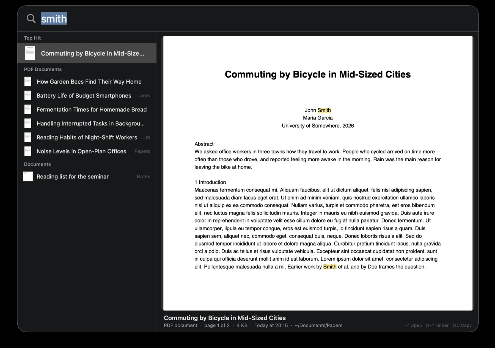

<p align="center"></p>

<h1 align="center">Cedar</h1>

<p align="center">A search bar for the Mac that looks inside your documents.<br>
Press ⌘Space, type what you remember, and read the result right there.</p>

<p align="center"><a href="https://github.com/kallekarlsson1/Cedar/releases/latest"><b>Download for Mac</b></a></p>

<p align="center">
<a href="https://github.com/kallekarlsson1/Cedar/releases/latest"></a>
<a href="LICENSE"></a>

</p>

<p align="center"></p>

Spotlight treats every word in a PDF the same, so searching for an author returns every paper that cites them
and buries the one they wrote. Cedar was built to fix that.

## What it does

- Finds documents by their contents: PDFs (scanned ones too), Word, PowerPoint, Excel, Markdown, text and HTML.
- Understands descriptions. "the paper about people using several chatbots" finds it even if those words
  aren't in it.
- Ranks a paper's title and authors above its body, and its body above its reference list.
- Shows the document in the panel, at the page that matched, so you can scroll and read without opening
  another app.
- Launches apps, finds files and folders by name, does math (`24*1.25`), currency (`100 usd`) and units
  (`5 km in miles`).

Everything runs on your Mac. Your files and what you type are never sent anywhere.

## Install

You need an Apple Silicon Mac with macOS 14 or later. Nothing else has to be installed.

1. Download `Cedar-x.y.z.dmg` from [Releases](https://github.com/kallekarlsson1/Cedar/releases/latest).
2. Open it and drag Cedar to Applications.
3. Open Cedar. macOS will say it can't verify the app, because Cedar isn't signed with an Apple Developer
   certificate. Go to System Settings → Privacy & Security, scroll down and click **Open Anyway**. This is
   needed once per version.
4. Turn off Spotlight's shortcut so ⌘Space reaches Cedar: System Settings → Keyboard → Keyboard Shortcuts →
   Spotlight. Or pick a different shortcut in Cedar's settings.

The first time it runs, Cedar downloads its language model (640 MB) and starts reading your files. You can
search straight away. Names work first, then contents, then search by meaning as documents get read. That last
part can take a few hours for a large library, and it waits for the charger when you're on battery.

To uninstall, delete the app and `~/Library/Application Support/Cedar`.

## Keys

| Key | |
|---|---|
| ↑ ↓, or hover | show a result in the reader |
| ↩ | open it |
| ⌘↩ | show in Finder |
| ⌘C | copy the selected text, the file, or the answer |
| ⌘+ ⌘− ⌘0, pinch, or ⌘-scroll | zoom the document in the reader |
| esc | clear, then close |

## Settings

Click the magnifying glass in the menu bar. You can change the shortcut, exclude folders, pause indexing and
turn off the exchange-rate download. Folders whose name ends in `.noindex` are always skipped, and so are
hidden folders and `~/Library`.

## Privacy

Cedar goes online for two things: the model download on first run, and the day's exchange rates (which you can
switch off). Neither request contains anything from your files or your searches. Files that exist only in
iCloud are listed by name and never downloaded.

## How it works

Cedar is one program that runs as three processes: the panel, an engine that indexes and searches, and a
helper that holds the model.

- **Index.** Two SQLite files in `~/Library/Application Support/Cedar`. One has every file name. The other has
  the text of your documents cut into passages of about 200 words, a keyword index (FTS5), and a vector for
  each passage.
- **Reading.** PDFKit for PDFs, Vision for scanned pages. Each paper is split into a title/author block, the
  body and the reference list, so a match in the author block counts more than a match in someone's citations.
- **Meaning.** [Qwen3-Embedding-0.6B](https://huggingface.co/Qwen/Qwen3-Embedding-0.6B-GGUF) runs on the GPU
  through [llama.cpp](https://github.com/ggml-org/llama.cpp). A passage only counts as a match if it clearly
  stands out, so a search for something you don't have returns nothing.
- **Memory.** Only a 128-byte code per passage is kept in memory. A search shortlists with the codes and scores
  the shortlist exactly from disk. The model is unloaded after two idle minutes.
- **Staying current.** Cedar listens for file changes, so a new file is searchable within seconds.

Documents older than two years only get their first pages embedded until you open them. All their words are
still searchable.

## For developers: build from source

None of this is needed to use Cedar; the download above is all a user needs. To build it yourself you need
the Xcode Command Line Tools, git, and cmake (or [uv](https://docs.astral.sh/uv/)).

```sh
./build.sh
open ~/Applications/Cedar.app
```

The first build compiles llama.cpp, which takes a few minutes.

`scripts/check.sh` runs the search-quality check: it indexes the made-up documents in `evals/corpus.noindex`
and checks that the queries in `evals/queries.json` find the right files. Run it before and after changing
anything about ranking.

`scripts/release.sh 0.2.0` builds the disk image in `dist/`.

## Limits

- Apple Silicon only.
- Not signed or notarized.
- No automatic updates yet.
- It doesn't search Mail, Messages, contacts or calendars.
- Search by exact word doesn't split Chinese, Japanese or Thai text into words.

## License

MIT. Cedar uses llama.cpp (MIT) and the Qwen3-Embedding model (Apache 2.0); see
`app/Resources/Acknowledgements.txt`.

The hybrid ranking was inspired by [DigUp](https://github.com/ARahim3/DigUp).
